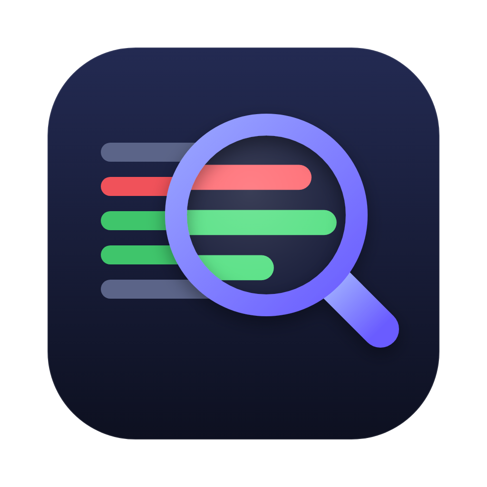
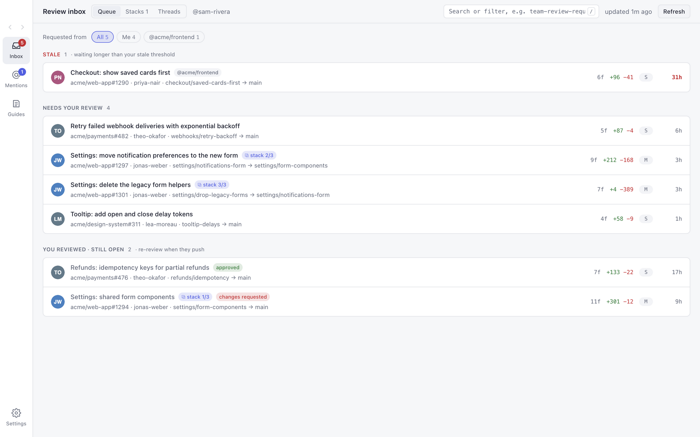
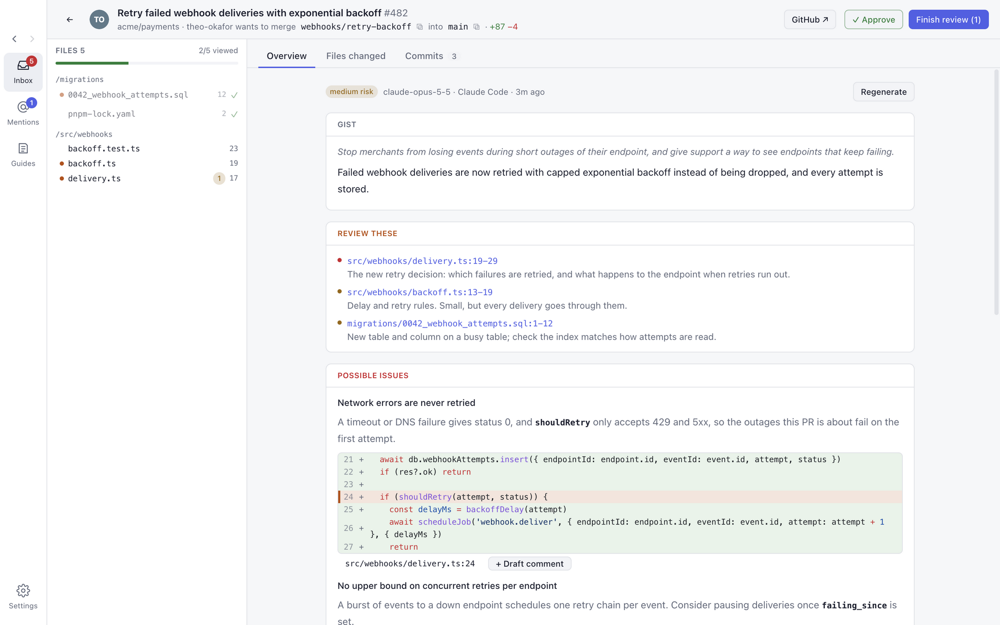
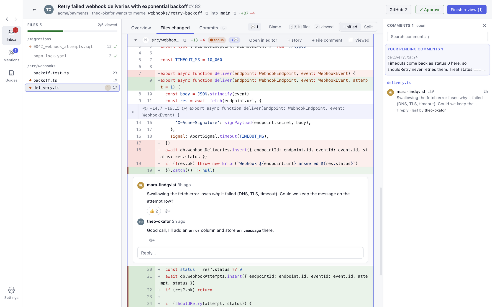

# Revio

An IRE, an **integrated review environment**: what an IDE is for writing code, Revio is for reviewing it. A macOS
desktop app that puts the whole review in one place: a review inbox with alerts, your own review guides per repo/folder,
a GitHub-style diff with draft comments, and a Claude briefing that tells you what a PR does, where to look and what to
skip.

<picture>
  <source media="(prefers-color-scheme: dark)" srcset="docs/screenshots/inbox-dark.png">
  
</picture>

**Claude briefing:** what the PR does, which lines to review first, possible issues with a one-click draft comment,
and what to skip.

<picture>
  <source media="(prefers-color-scheme: dark)" srcset="docs/screenshots/briefing-dark.png">
  
</picture>

**Diff and comments:** a GitHub-style diff with focus markers, threads and reactions, your pending comments, and
viewed-file tracking.

<picture>
  <source media="(prefers-color-scheme: dark)" srcset="docs/screenshots/diff-dark.png">
  
</picture>

## Install

Download the latest `Revio-<version>-arm64.dmg` from
[Releases](https://github.com/douglas-pires/revio/releases) and drag Revio into Applications. To build it yourself:

```bash
pnpm install
pnpm dev        # run from source
pnpm dist       # build a .dmg into dist/
```

## Configuration

Most of this lives in **Settings**.

**GitHub:** Revio uses, in order: a token pasted in **Settings → GitHub** (checked with GitHub, then stored encrypted
via the macOS keychain), `GITHUB_TOKEN` (or `GH_TOKEN`) in the project's `.env` when running from source, then
`GH_TOKEN` / `GITHUB_TOKEN` from the environment, then `gh auth token`. Settings shows which one is in use, the
account and its scopes. Team names on team review requests need `read:org`; Settings warns when the token lacks it.

**Claude:** "Auto" uses an Anthropic API key if one is set (Settings or `ANTHROPIC_API_KEY`), otherwise your local
Claude Code login via `claude -p` with structured JSON output. You can pick the backend (API or CLI) and the model;
the default model is `claude-opus-5-5`.

**Inbox and alerts:** how often to poll GitHub, whether team review requests count (not only requests to you),
whether to skip draft PRs, after how many hours a requested review turns _stale_ and how often to repeat that alert,
and which desktop notifications to show (new or re-requested reviews, stale reviews, mentions).

**Editor:** which editor **Open in editor** uses (Cursor, VS Code, Windsurf, Zed, JetBrains IDEs, Sublime Text,
Nova or Xcode; Automatic picks the first one installed), and extra folders to look for local clones in. Revio finds a
clone by its GitHub remote, in those folders and your home folder and one level below them.

**Updates:** installed builds check the latest GitHub release a little after launch and every 6 hours; **Revio →
Check for Updates…** and **Settings → Updates** check on demand. When a newer version is out, a bar at the top offers
**Update** and **What's new**. Update downloads it in the background, then **Restart to update** replaces Revio and
opens it again (quitting installs it too). A copy that cannot replace itself, such as one run from the dmg, offers the
dmg for this Mac to drag into Applications instead.
Only releases are offered, not the pre-releases built from every merge; see [Releasing Revio](docs/releasing.md).

**Feedback:** **Settings → Feedback** opens a bug report or feature request as an issue on Revio's GitHub
repository, as your GitHub account. A bug report can add basic system info (Revio version, macOS version, chip and
memory, Electron, Chrome and Node versions, locale), shown before you send it. When your token cannot open issues
there, GitHub's new-issue form opens in the browser, filled in.

All data stays on your Mac, in `~/Library/Application Support/Revio/`.

## Features

### Inbox search

The search box (press `/`) takes free text plus GitHub's qualifiers:

| Qualifier                                                                   | Keeps                                                           |
| --------------------------------------------------------------------------- | --------------------------------------------------------------- |
| `user-review-requested:@me`                                                 | Requests addressed to you directly                              |
| `team-review-requested:web` (or `org/web`, `*` for any team)                | Requests that reach you through a team                          |
| `review-requested:@me`                                                      | Every open request, hiding PRs you already reviewed             |
| `repo:`, `author:`, `head:`, `base:`                                        | One repository (owner/name or name), author, or branch          |
| `is:stale`, `is:draft`, `is:stacked`, `is:approved`, `is:changes-requested` | Those states                                                    |
| `is:bot`                                                                    | Threads whose last comment is from a bot (`-is:bot` hides them) |

Prefix any qualifier with `-` to exclude it. The **Requested from: All · Me · @team** buttons rewrite the query the
same way. Without the `read:org` scope GitHub hides team names, so team requests are grouped as `@team`;
`gh auth refresh -s read:org` shows the real names. The search is kept while you open a PR and come back.

### Threads

The inbox's **Threads** tab lists unresolved review threads on open PRs you are involved in (yours, or ones you
commented on), in two groups: **Waiting on your reply** (someone else spoke last) and **Waiting on others** (your
comment has no answer yet), oldest first and grouped by PR. The tab count is how many wait on you. Clicking a
thread opens the PR at that file and line; outdated threads open the file. **Reply** posts right away (⌘↵) and moves
the thread to _Waiting on others_; **Resolve** resolves it on GitHub and keeps the row with **Undo** until the next refresh. The search box filters threads too (PR,
file path, comment text, `repo:`, `author:`, `-is:bot`). It covers the 30 most recently updated PRs you are involved
in, and the last 10 comments of each thread; general PR conversation comments are not included, since only review
threads can be resolved. Threads load when the inbox opens (reused for 2 minutes) and on **Refresh**.

### Stacked PRs

The inbox has a **Queue / Stacks** switch. Revio detects stacks from branches (a PR whose base branch is another open PR's
head branch sits on top of it), walking up and down from every PR in your inbox, so stack members that were not
requested from you show up too (marked _not requested_). Stacks are listed bottom-up, which is review order. Queue rows in a stack get a
**⧉ stack 2/4** chip that jumps to the stack.

Inside a stacked PR, a stack bar under the header shows every PR in the stack (with status dots), **‹ Prev / Next ›**,
and a warning when the PR it builds on is not approved yet.

### Markdown

PR descriptions, comments, guides and Claude answers render like GitHub: inline HTML (`<details>`, ``,
`<p align>`…) sanitized with GitHub's allow-list, and ` ```mermaid ` blocks drawn as diagrams (loaded on demand,
follows light/dark; click a diagram to zoom, hover for **Source**). Links open in your browser. Images that need a
GitHub login become links.

Fenced code is syntax highlighted by its language (` ```ts `, ` ```python `…), selectable, and has a
**Copy** button on hover. GitHub ` ```suggestion ` blocks are labeled _Suggested change_ and highlighted as the
language of the file they comment on.

### Mentions

The **Mentions** item in the sidebar lists PRs where someone mentioned you (`@you`) or one of your teams
(`@org/team`, needs `read:org`) in the last 14 days: in the description, a comment, a review or a review comment.
Each mention shows who, where (file and line for review comments) and the text around the mention, newest first.
**New** means unread in your GitHub notifications; the sidebar badge counts PRs with new mentions.

- Clicking a mention opens the PR (at the line for review comments) and marks its GitHub notification read, as
  github.com does. **Mark read** does only the latter. **GitHub ↗** opens the comment on GitHub, useful for
  conversation comments, which Revio's PR view does not show.
- Candidates come from both `mentions:@me` search and your notifications, because search misses some review
  comments and a notification keeps only its latest reason. Mentions in code blocks or quoted replies don't count,
  nor do your own comments.
- A desktop notification fires for each new mention (Settings → Alerts → "Notify when you or your team are
  mentioned"); the first fetch after install records existing ones silently. Mentions refresh with the inbox.
- Fine-grained tokens cannot read notifications: mentions still show, but none are marked new.

### Comments panel

On **Files changed**, the right-hand panel lists every review thread grouped by file (in file-list order), with who
started it, a preview, replies and the last replier. Open threads show by default; **Show N resolved** reveals the
rest. Your pending (draft) comments are listed at the top. Clicking an item jumps to its line. The 💬 button in the tab
bar shows the open count and hides or shows the panel (remembered). The Ask Claude panel takes its place while open.

### Diff tips

- Click a line number to comment; **click and drag** down the line numbers (or **shift-click**) to comment on a range.
- **± Suggest change** inserts a GitHub `suggestion` block with the selected lines.
- Drafts persist locally until you **Finish review** (Comment / Approve / Request changes), or use **✓ Approve** in the PR header.
  Submitting takes you back to the inbox. A chip shows your last review on the PR (e.g. _You approved · new commits since_).
- "Viewed" resets automatically when a file changes in a new push.
- **⌘F** finds text in the changed files, including files you have not scrolled to yet: **↵** / **⌘G** next match,
  **⇧↵** / **⇧⌘G** previous, **Aa** to match case, **Esc** to close.
- **⌘P** goes to a changed file: type part of its path (matched fuzzily, file names first), then **↵**.
- Drag the inner edge of a side panel (files, comments, file history, the Claude chat, commit details, guides) to
  make it wider or narrower; **← / →** on the focused edge works too, and double-click returns to the default width.
  Each panel remembers its width, up to half the window.
- **Keyboard:** `j` / `k` next / previous file, `v` toggles viewed and jumps to the next unviewed file (ignored while typing).
- **Unified / Split** toggle above the files; code is syntax highlighted (Shiki, per hunk, no WebAssembly).
- Click a branch name in the PR header to copy it (e.g. to `git checkout` it locally).
- Hover a path that is cut off to see it in full; **⧉** next to a file's path copies it.
- The file header (path, size, History, file comment, Viewed) stays at the top while you scroll through a long file.
- **↑ / ↓** on a hunk header show 20 more lines of the file above or below it; **↕** shows the rest of a short gap.
  These lines come from the PR head and take no comments, as on GitHub.
- **Open in editor** opens the file in your editor from your local clone, at the selected line or the first change.
  It opens whatever branch you have checked out there.

### Back and forward

Revio keeps a browser-style history of the screens you visit. Go back and forward with the arrows at the top of the
sidebar, **Go → Back / Forward** (`⌘[` / `⌘]`), your mouse's side buttons, or a three-finger swipe (when "Swipe
between pages" is on in System Settings). The ← in a PR's header goes back too. Returning to a PR does not repeat
the jump it was opened with.

### Comment on a whole file

**+ File comment** in a file's header comments on the file without picking a line (it expands the file if needed).
These show under **On this file** at the top of the diff, alongside GitHub's existing file comments, and in the
comments panel as "file". They are added to your review like line comments.

### Blame and file history (GitLens-style)

- **Blame** above the files turns on line blame: hover a line to see who last changed it, when, and the commit
  message, after the code. Click it to open the commit on GitHub. Blame is for the PR head and loads per file as you
  scroll to it.
- **History** in a file's header opens the file's last 30 commits in a side panel, with this PR's own commits marked.
  Expand one to see what it changed in that file, copy its sha or open it on GitHub.

- **Commits** tab: the PR's commits, oldest first like GitHub, with author, age and a copyable sha. Expand one for its
  full message and the files it changed, each opening to its diff.

### Searching comments

The comments panel on the right has a search box (`/` to focus, Escape to clear). It filters threads and your pending
comments by text, author or file path, resolved and outdated threads included, marks the match, and clicking a result
lands on the matching comment.

### Replying from a mention

Opening a mention of a review comment lands on that comment with its thread's reply box open: **Reply now** posts
right away, **Add to review** holds it for your review. Outdated threads can be replied to as well. A mention in the
PR conversation (or description) shows at the top of the overview with a quote reply ready, posted as a conversation
comment.

### Reactions

Review comments show their emoji reactions. Click one to add or take back yours, or **☺+** to pick any of GitHub's
eight (👍 👎 😄 🎉 😕 ❤️ 🚀 👀). Your reaction shows right away and is sent to GitHub at once (not held for the review);
if GitHub refuses, it is rolled back with the reason.

### Ask Claude about a selection

Select code in the diff with the mouse (or use the **✦ Ask Claude** button in the comment box after picking lines in
the gutter). Claude gets the selected lines, the whole file at the PR head (and at the base for removed lines),
the PR description, the full diff, your guides and the briefing gist. Answers stream into a side panel; follow-ups
keep the conversation, and **Use as draft comment** turns an answer into a pending comment on those lines.
The code the chat is about is highlighted and can be copied. Conversations are saved per PR: the header button
**✦ N Claude chats** opens the latest, and **Chats N** in the panel lists them all with their first question, so you
can switch between them or delete one.

## License

[GPL-3.0-or-later](LICENSE).
